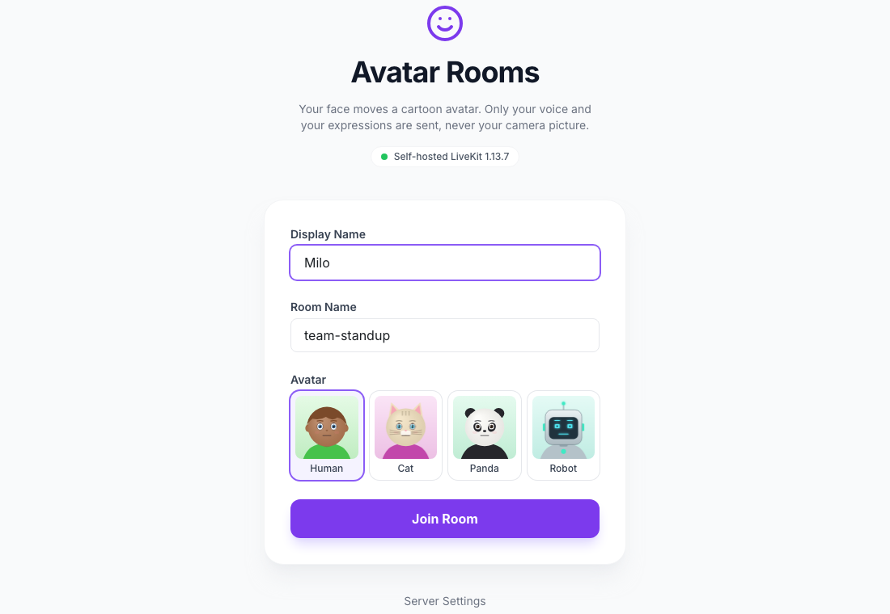
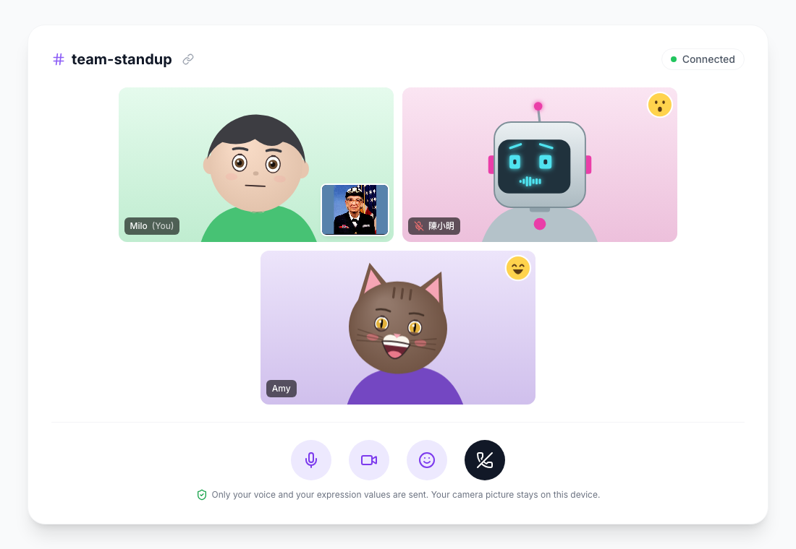
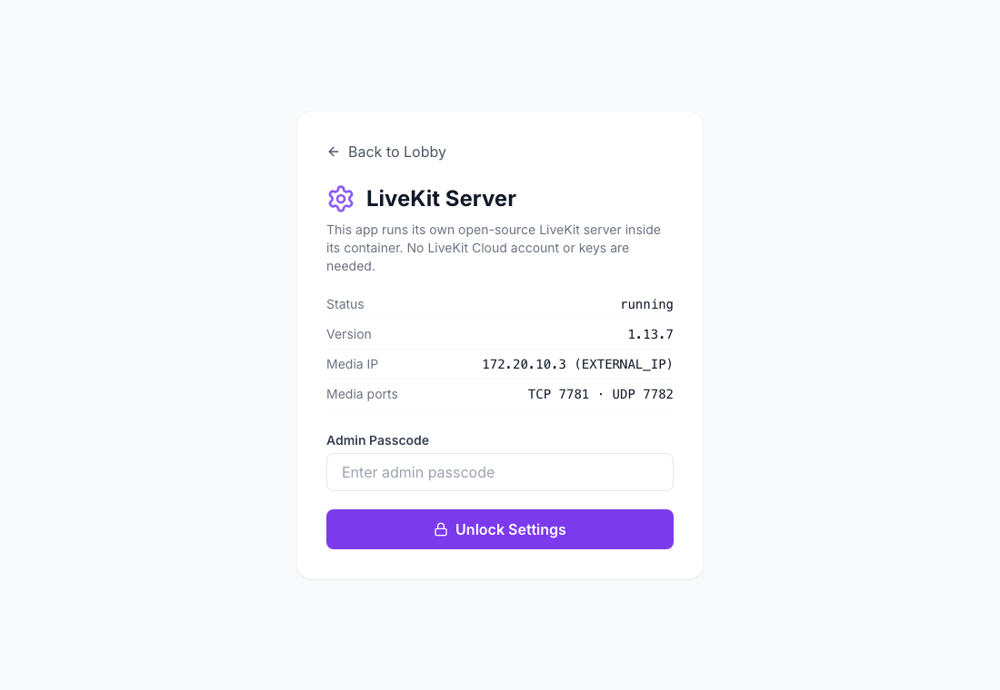
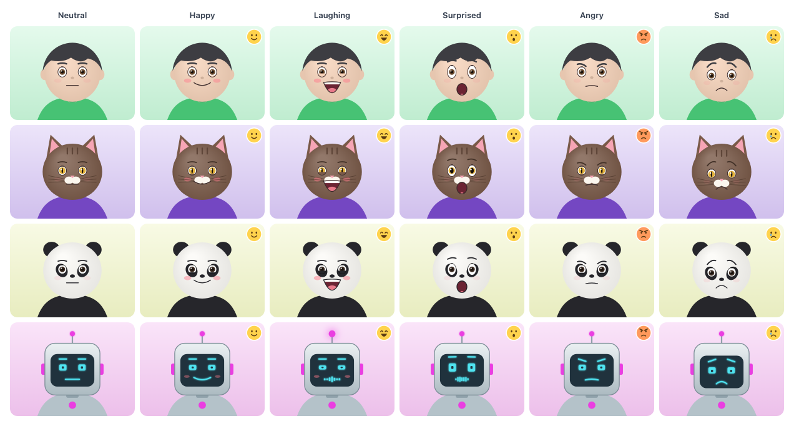

# Reflex DDNS LiveKit Avatar Chat 😊

Voice calls with **emotional cartoon avatars**, built with [Reflex](https://reflex.dev/) on a **self-hosted, open-source [LiveKit](https://github.com/livekit/livekit) server that runs inside the app's own container**. Your browser reads your face from the camera and turns each frame into 51 expression values plus your head pose. It sends only those numbers and your voice; everyone else's browser draws your avatar from them. Your camera picture never leaves your device.

Install it on [re-ddns](https://github.com/milochen0418/re_ddns) and everyone on your network can meet as avatars at `https://avatar-chat.reflex-ddns.com`. There is no LiveKit Cloud account and nothing to configure. It is a sibling of [reflex_ddns_livekit_audio_chat](https://github.com/milochen0418/reflex_ddns_livekit_audio_chat) and [reflex_ddns_livekit_video_chat](https://github.com/milochen0418/reflex_ddns_livekit_video_chat): the same lobby, embedded server, `/settings` and `call.join` intent. All three can be installed side by side.

## 📸 Interface Preview

| Lobby | Avatar room | Server status |
|:---:|:---:|:---:|
|  |  |  |



## 🌟 Features

- **Face tracking on the device**: [MediaPipe Face Landmarker](https://ai.google.dev/edge/mediapipe/solutions/vision/face_landmarker) (WebAssembly, vendored in `assets/mediapipe/`) reports the 51 ARKit blendshapes and the head pose about 25 times a second. Each blendshape is measured from your own resting face, so a relaxed face draws as neutral.
- **Avatars**: Human, Cat, Panda and Robot, drawn on a canvas with a 2.5D head that turns, nods and tilts. Pick one in the lobby or switch with *Change avatar* during a call. The choice is remembered in the browser, also inside other apps' call dialogs. Colors follow each person's name.
- **Expressions**: blinks and winks, gaze, brows, smiles and laughs, frowns, talking, an "O" of surprise, a kiss, puffed cheeks. A badge shows the mood the face reads as (happy, laughing, surprised, angry, sad, wink, kiss).
- **Without a face** (camera off, or no face in view) the avatar idles: it blinks, breathes, and its lips follow your voice.
- **Only audio and numbers on the network**: each face frame is a 60-byte data packet, and unchanged frames are skipped. The token lets participants publish only their microphone, so the server refuses video. Measured in the tests, per person: ~39 kbit/s audio + 12-16 kbit/s face data, versus ~1.5 Mbit/s of camera video in the video chat app.
- **Your own tile** shows your camera picture in a corner (only on your device) and what the tracker is doing (*Looking for your face…*).
- As in the audio app: mute, leave, invite links, *Click to enable audio* when the browser blocks autoplay, the embedded LiveKit server, `/settings`, and the `call.join` intent for other apps. Nothing loads from a CDN.

## 📐 How it works

```
Your browser
  camera ─► MediaPipe Face Landmarker (WASM, on the device)
              └─► 51 blendshapes + head pose ─► face packet (60 bytes, ≤25/s) ─┐  LiveKit data packet,
  microphone ───────────────────────────────► Opus audio track ────────────────┤  topic "face", lossy
                                                                                ▼
                               livekit-server in this app's container (accepts audio + data only)
                                                                                │
Everyone else's browser  ◄─ audio + face packets ◄──────────────────────────────┘
  AvatarFace draws your avatar on a <canvas> every animation frame, smoothing between packets
```

Signalling and media take the same path as in the audio app: `https://avatar-chat.reflex-ddns.com/rtc` is relayed by the Reflex backend to `livekit-server` on `127.0.0.1:7780`, and media (audio and the data channel) goes to the published ports TCP 7781 / UDP 7782 on the host's LAN IP (`EXTERNAL_IP`). The ports sit 100 below the audio app's (7880-7882), and the video app uses 7980-7982.

| File | Role |
|------|------|
| `assets/face_tracker.js` | Camera → MediaPipe → calibrated blendshapes + head pose. Loads MediaPipe on first use; uses the GPU when it is a real one. |
| `assets/avatar_face.js` | Draws the four avatars from the blendshapes (and the mood badge). The face is drawn as the camera sees the person; your own tile is mirrored. |
| `assets/livekit_bridge.js` | Reflex state ↔ LiveKit JS client: join/leave/mute/camera/style, the face packets (format below), smoothing and idle animation, drawing every tile. |
| `assets/mediapipe/` | Vendored `@mediapipe/tasks-vision` 1.0.1 (SIMD WASM) and `face_landmarker.task`; sources, licenses and checksums in its `NOTICE.md`. |
| `reflex_ddns_livekit_avatar_chat/livekit_server.py`, `livekit_proxy.py` | The embedded LiveKit server and the `/rtc`, `/twirp` relays, as in the audio app. |
| `backend-paths.txt` | Tells re-ddns nginx to send `/rtc` and `/twirp/` to the backend port. |

**Face packet** (version 1, 60 bytes; LiveKit data packet, topic `face`, lossy):

| Bytes | Content |
|-------|---------|
| 0 | `0xA1` (format and version) |
| 1 | flags: 1 = face found, 2 = camera on |
| 2 | avatar style: 0 human, 1 cat, 2 panda, 3 robot |
| 3 | sequence number (older packets that arrive late are dropped) |
| 4–54 | the 51 ARKit blendshapes in MediaPipe's order (`AvatarFace.SHAPES`), each 0–255 for 0–1 |
| 55–57 | head yaw, pitch, roll in degrees (int8; + = nose to the camera image's right, looking down, clockwise) |
| 58–59 | head x, y offset (int8, hundredths) |

Without a face, the jaw value carries the voice level, so lips still move. Any renderer that reads ARKit blendshapes (e.g. a 3D model with morph targets) could draw the same stream.

## 🚀 Install on re-ddns (Agentic App Store)

The App Store catalog (`re_ddns/data/appstore_catalog.json`) has an entry for this app:

```json
{
  "id": "ddns-livekit-avatar-chat",
  "subdomain": "avatar-chat",
  "github_repo": "https://github.com/milochen0418/reflex_ddns_livekit_avatar_chat.git",
  "app_name": "reflex_ddns_livekit_avatar_chat",
  "ports": ["7781:7781", "7782:7782/udp"]
}
```

1. Open `https://aapps.reflex-ddns.com` and install **LiveKit Avatar Chat (self-hosted)**. The admin passcode is optional.
2. Open `https://avatar-chat.reflex-ddns.com`, pick a name, a room and an avatar, allow camera and microphone, and share the invite link.

The first start downloads `livekit-server` (about 17 MB) from GitHub releases. The face tracker (about 16 MB) ships with the app and is cached by the browser after the first call.

From the command line:

```bash
./smart_launch.sh -p 7781:7781 -p 7782:7782/udp \
  https://github.com/milochen0418/reflex_ddns_livekit_avatar_chat.git reflex_ddns_livekit_avatar_chat avatar-chat
```

## 💻 Run locally

Prerequisites: Python 3.11, [Poetry](https://python-poetry.org/docs/#installation) and the LiveKit server binary. On macOS install it with `brew install livekit`; LiveKit publishes no macOS release binaries, while Linux downloads them automatically.

```bash
poetry env use python3.11
poetry install
poetry run ./reflex_rerun.sh
```

Open `http://localhost:3000`. Browsers only allow the camera and microphone on secure origins: `localhost` counts as one, but from another machine use HTTPS, e.g. through re-ddns.

`reflex_rerun.sh` also stops the detached `livekit-server` (port 7780) so the restarted backend starts a fresh one. Runtime files (binary, keys, config, `livekit-server.log`) live in `~/Library/Application Support/reflex_ddns_livekit_avatar_chat` on macOS and in `~/.local/share/reflex_ddns_livekit_avatar_chat` on Linux.

> If the Docker deployment runs on the same machine, it owns ports 7781/7782. Run the local copy on other media ports:
> `LIVEKIT_RTC_TCP_PORT=7791 LIVEKIT_RTC_UDP_PORT=7792 poetry run ./reflex_rerun.sh`

## ⚙️ Configuration (all optional)

| Variable | Default | Purpose |
|----------|---------|---------|
| `ADMIN_PASSCODE` | *(empty)* | Unlocks the admin part of `/settings`. |
| `LIVEKIT_NODE_IP` | `EXTERNAL_IP`, else auto | IP address browsers send audio and face data to (`rtc.node_ip`). It can also be set on `/settings`. |
| `LIVEKIT_API_KEY` / `LIVEKIT_API_SECRET` | generated | Fixed credentials, e.g. to share the server with other apps. The secret needs 32+ characters. |
| `LIVEKIT_RTC_TCP_PORT` / `LIVEKIT_RTC_UDP_PORT` | `7781` / `7782` | ICE/TCP port and ICE/UDP mux port. These must match the published ports. |
| `LIVEKIT_PORT` | `7780` | Signalling/API port (localhost only). |
| `LIVEKIT_SERVER_BIN` | PATH, then download | Use a specific `livekit-server` binary. |
| `LIVEKIT_SERVER_VERSION` | `1.13.7` | Release downloaded on Linux. |
| `LIVEKIT_HOME` | see above | Directory for runtime files. |
| `LIVEKIT_PUBLIC_URL` | the app's `api_url` | LiveKit URL handed to browsers. |
| `LIVEKIT_LOG_LEVEL` | `info` | livekit-server log level. |

## 🔗 Use this server from other *.reflex-ddns.com apps

The embedded server is a normal LiveKit server, so any LiveKit SDK can join the same rooms. To appear as an avatar, send face packets in the format above.

- **Client SDKs** (browser, mobile): `wss://avatar-chat.reflex-ddns.com`
- **Server SDKs** (tokens, RoomService): `https://avatar-chat.reflex-ddns.com` from the LAN, or `http://smart-app-avatar-chat:8000` from containers on the re-ddns network
- **API key / secret**: shown on `/settings` (admin), or chosen with `LIVEKIT_API_KEY` / `LIVEKIT_API_SECRET`.

## 📞 Calls from other apps (DDNS Intent `call.join`)

This app implements the same `call.join` contract as the audio and video chat apps, so callers such as relack and codoc_in_md need no change. The dialog loads `/intent/call-join`, which joins the LiveKit room right away (microphone on, face tracking starting), and answers the caller when the user hangs up:

```python
from reflex_ddns_auth.intent import Intent, intent_host

rx.button("Call", on_click=Intent.start(
    None, "call.join",              # None: whichever installed app provides call.join
    on_result=MyState.call_ended,   # {"status": "ended", "room": <room>} after hang up
    on_cancel=MyState.call_ended,   # {"reason": "closed" | "cancel" | "replaced" | ..., ...} otherwise
    private={"room": call_id},      # posted to the dialog, kept out of the URL
    keep_alive=True,                # other dialogs minimize the call instead of ending it
    single=True,                    # one call at a time: a new call closes the previous one
    label="Call · Design Review",   # shown in the tray while minimized
    title="Design Review", user="amy@example.com", name="Amy",
))
intent_host()  # once per page; delegates camera, microphone + autoplay to the dialog
```

| Param | Meaning |
|-------|---------|
| `room` | Required. Call id, used as the LiveKit room name. Everyone opening the same `room` is in the same call. Use an unguessable id for private calls: the rooms themselves have no access control. Pass it with `private=` so it stays out of URLs and logs. |
| `title` | Shown instead of the id (e.g. the chat room's name). |
| `name` | Display name of the participant. |
| `user` | Stable account id (e.g. an email), the base of the participant identity. |

The params are declared on the intent (`params=`, `required=("room",)`): a call without `room` shows an error, and Close answers `cancel` with `{"error": ...}`. The app publishes this contract, titled *Avatar Call*, at `/_ddns_intent/manifest`, which the re-ddns intent registry reads.

**Audio, video or avatar?** When several call apps are installed, the caller's dialog first asks which one to use (*Open with*: `livekit`, `video-chat`, `avatar-chat`). Each app runs its own LiveKit server, so **everyone in a call has to pick the same app**; otherwise they end up in separate rooms. To skip the question, name the app in the caller: `Intent.start("avatar-chat", "call.join", ...)`, or set `RELACK_CALL_APP=avatar-chat` on relack or `CODOC_CALL_APP=avatar-chat` on codoc_in_md. For local development of a caller without the registry, use `DDNS_INTENT_PROVIDER_CALL_JOIN=avatar-chat DDNS_INTENT_URL_AVATAR_CHAT=http://localhost:3400`.

## 🧪 Tests

Playwright suites live in `testcases/` (see [testcases/README.md](testcases/README.md)):

```bash
poetry run ./run_test_suite.sh smoke_home         # lobby, avatar previews, server, /rtc relay, MediaPipe files
poetry run ./run_test_suite.sh two_users_avatar   # real face tracking, face packets, no video, expressions, controls
ADMIN_PASSCODE=test-pass poetry run ./run_test_suite.sh settings_admin
poetry run ./run_test_suite.sh call_intent        # call.join opened by a fake caller app
```

The fake camera of `two_users_avatar` and `call_intent` shows a real face (`testcases/fixtures/face.mjpeg`, a public-domain portrait), so MediaPipe tracks it. Exact expressions are set with `window.livekitClient.injectFace({...})` and checked on the other side.

## 🩺 Troubleshooting

| Symptom | Fix |
|---------|-----|
| *Looking for your face…* stays | Face the camera in good light, about an arm's length away. The thumbnail in your tile shows what the camera sees. |
| *Camera unavailable* | Permission was denied, there is no camera, or another app holds it. The call goes on: your avatar idles and its lips follow your voice. Allow the camera in the browser's site settings, then turn it on again. |
| The avatar's lips don't follow the voice while the camera is off | The browser has not allowed audio processing yet. Click *Click to enable audio*, or anywhere on the page. |
| Joined but silent, or stuck on *Connecting...* | Media can't reach the server. On `/settings`, *Media IP* must be the Docker host's LAN IP and the media ports must be published (`docker port smart-app-avatar-chat`). Allow UDP 7782 / TCP 7781 in the host firewall. |
| *address already in use* in the status | Another LiveKit instance holds 7781/7782 (e.g. the Docker deployment and a local run on the same Mac). Use other ports, see above. |
| *livekit-server not found on PATH* | macOS: `brew install livekit`. |
| No camera prompt when opening the page from another machine over `http://` | Browsers only give camera and microphone to secure origins. Use `https://avatar-chat.reflex-ddns.com` (or `localhost`). |
| Two people "in the same call" can't hear each other | They opened it with different call apps. See *Audio, video or avatar?* above. |

## 📄 License

MIT, see [LICENSE](LICENSE). Bundled third-party files are Apache-2.0: [livekit-client](https://github.com/livekit/client-sdk-js) (`assets/livekit-client.umd.js`, v2.22.3), [MediaPipe Tasks Vision](https://github.com/google-ai-edge/mediapipe) and the Face Landmarker model (`assets/mediapipe/`, see its `NOTICE.md`), and the downloaded [livekit-server](https://github.com/livekit/livekit). The test portrait is in the public domain (see `testcases/fixtures/README.md`).
